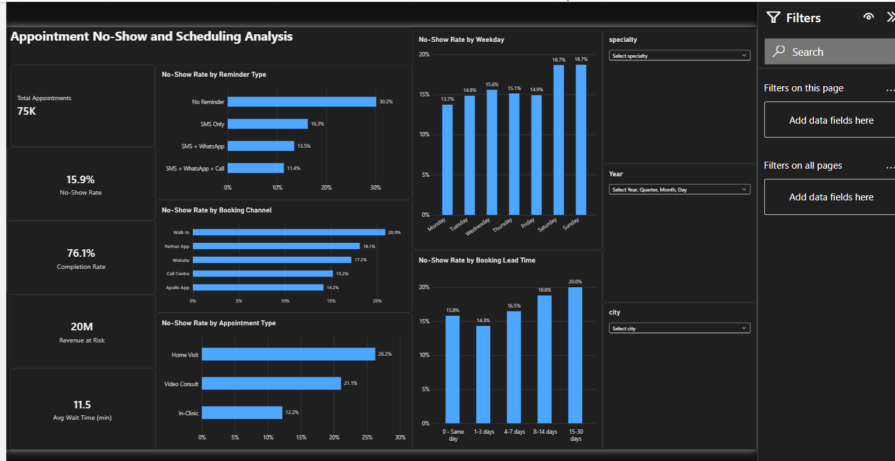
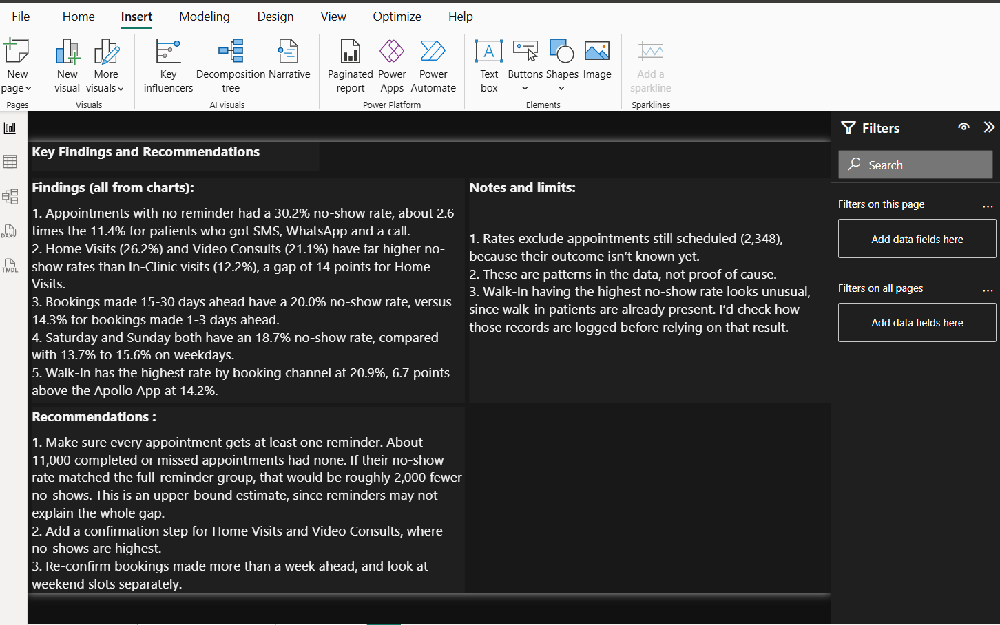

# Hospital Appointment No-Show and Scheduling Analysis (Power BI)

An interactive Power BI dashboard analysing 75,000 hospital appointments (2022-2024) to find what drives no-shows and where scheduling can improve.

## Dataset
Apollo Hospitals appointment data (public): https://github.com/RanjeetChoudhary13/Apollo-Hospitals-Appointment-EDA
Two tables: appointments (75,000 rows) and doctors (320 rows), linked on doctor_id.

## Tools
Power BI, Power Query, DAX

## KPI definitions
- No-Show Rate = no-shows / finalised appointments (completed + no-show + cancelled). Appointments still scheduled are excluded.
- Completion Rate = completed / finalised appointments.
- Revenue at Risk = listed consultation fees of no-show appointments.
- Avg Wait Time = average wait in minutes, completed appointments only.

## Key findings
(paste your 5 findings)

## Recommendations
(paste your 3 recommendations)

## Limitations
(paste your notes and limits)

## Screenshots

